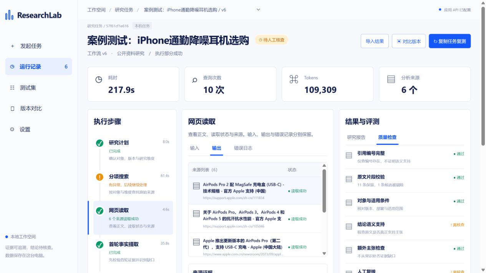

# ResearchLab · 研究型 Agent 运行与评测工作台

面向产品经理的公开资料研究原型：把一次竞品研究拆成可查看的任务、检索、证据、事实、报告与复核记录。

**项目状态：个人作品集 MVP，已完成真实服务 API 与网页运行测试。不是生产级采购系统，也不保证自动研究结论正确。**



截图为本机历史真实运行；公开示例是缩减回放摘要，内容范围不同。

## 要解决的产品问题

产品选型时，一篇流畅报告仍可能混淆版本、引用不支持结论，或把没找到写成不存在。ResearchLab 的目标是让研究过程可检查，让用户知道哪些能参考、哪些还需要补证据。

- 目标用户：做工具选型、竞品研究的产品经理与小团队。
- 首要场景：内部知识问答平台初筛；食品和耳机用于探索跨品类边界。
- 核心价值：管理研究任务和证据质量，而非仅生成一篇报告。
- 产品形态：Dify 编排研究执行；本地 Web 面板管理运行、证据、报告和复核。

## 已实现的产品能力

| 用户动作 | 系统行为 | 产品取舍 |
|---|---|---|
| 定义研究任务 | 记录用途、候选型号、维度、约束与资料 | 每次支持1–2个候选、最多4个维度 |
| 发起运行 | 查询拆分、逐项检索、网页读取、缺口补搜 | 只补搜一轮，避免无限调用 |
| 检查结论 | 展示事实、来源、原文片段、截断与缺失 | 引用存在不等于语义正确 |
| 遇到异常 | 保留失败和部分成功状态 | 不自动反复重跑，避免重复消耗 |
| 人工复核 | 保存独立意见，保留模型原始状态 | 不把模型复核通过写成独立事实认证 |
| 比较版本 | 复制任务复测、查看历史差异 | 未实现单节点重跑 |

## 演示与启动

本地面板：**http://127.0.0.1:8765/**，需要先运行服务；此地址不是互联网公开链接。

```powershell
cd panel
.\start.ps1
```

需要 Python 3.10+。首次启动安装依赖，只监听本机。无密钥也可创建任务、导入 `examples/case-1.json` 等脱敏回放摘要；回放不调用模型。实时执行需另行导入 `workflow/researchlab-v6.yml`、配置自己的模型与 Tavily 工具、发布 Dify 应用，并在面板设置中填写自己的应用 API Key。插件版本和模型可用性以使用者环境为准，不承诺导入后零配置。

实时流程：任务 → 查询矩阵 → 搜索/读取 → 证据整理 → 首轮事实 → 覆盖缺口 → 限次补搜 → 最终事实 → 草稿 → 语义复核 → 人工意见。

## 真实测试中的发现

| 案例 | 耗时 | 来源数 | 结果与价值 |
|---|---:|---:|---|
| Dify/n8n 内部问答选型 | 274.8秒 | 7 | 待复核；识别应用级Tracing与节点Last run的引用混用 |
| AirPods/Sony 耳机选购 | 217.9秒 | 6 | 待复核；识别把模型对旧兼容列表的解释当作官方声明 |
| Venchi 两款礼盒 | 155.1秒 | 1 | 模型复核通过，但证据严重不足；不能据此作购买推荐 |

这些是有限样本的单次运行记录，不是平均性能或准确率。公开回放已缩减、脱敏，不含完整页面正文。详见 [测试复盘](docs/validation.md)。

## 作品集阅读入口

- [产品方案与取舍](docs/product.md)：用户问题、需求、架构、指标与路线图
- [简历和面试使用指南](docs/career.md)：可直接改写的简历条目与追问回答
- [3分钟 Demo 脚本](docs/demo.md)：如何演示真实回放和实时流程
- [安装与数据边界](docs/setup.md)
- [测试复盘与局限](docs/validation.md)

## 工程验证

```powershell
cd panel
.\.venv\Scripts\python.exe -m unittest -v test_app.py
node --check static/execution.js
```

后端：FastAPI、SQLite、httpx；前端：原生 HTML/CSS/JavaScript；执行：Dify Workflow + Tavily + 已配置的大模型。当前不是 React 项目。代码、文档和调试使用 AI 编程辅助；产品决策及测试结论应能由项目作者解释。

## 边界

没有生产用户、商业收益、统计有效的准确率或节省工时结论；未实现多租户权限、自动独立事实认证、真实金额账单、单节点重跑。当前部署是本地原型。密钥留在后端，Windows 可使用当前用户 DPAPI 加密；源代码不包含原始数据库、个人截图或凭据。不要把本机后端直接暴露到公网。

第三方 Dify、Tavily、模型和官方文档各自受其许可证及服务条款约束。仓库未另行授予开源许可证。
